  

# 🛡️ Awesome AI Guardrails & Prompt Sandboxing

  
  
  
  
  
  
  

## 🚀 Top AI Guardrails & Prompt Sandboxing Ecosystem

> 🔒 **A curated repository of production-grade SaaS products, open-source frameworks, and isolation runtimes engineered for Prompt Injection Defense, Programmable LLM Guardrails, MicroVM Agent Sandboxing, PII Redaction, and Continuous Adversarial Red-Teaming.**

*Track and compare the state-of-the-art defenses securing LLM applications, generative AI workflows, and autonomous coding agents against jailbreaks, unauthorized system execution, and data exfiltration.*

📅 **Last updated:** November 2026

---

### 🌟 Key Defense Pillars Covered
- 🛡️ **Prompt Injection & Jailbreak Defense:** Real-time firewalls intercepting direct, indirect, and multi-turn adversarial prompt injections.
- 🧱 **MicroVM & Kernel Sandboxing:** Hardware-isolated KVM MicroVMs and unprivileged Linux namespaces restricting agent shell, filesystem, and network access.
- 📋 **Programmable Guardrail Frameworks:** Colang, Python schema validators, and declarative rule engines enforcing structural and topical safety.
- 🎭 **Context-Aware PII & Secrets Redaction:** Automated masking of sensitive credentials, API keys, and personal identifiers prior to ingestion.
- 🎯 **Adversarial Red-Teaming & Threat Evaluation:** Automated testing suites benchmarking language models against the OWASP Top 10 for LLMs.

---

## 📑 Table of Contents

- [📊 Sector Overview & Market Dynamics](#-sector-overview--market-dynamics)
- [☁️ SaaS/Hosted Platforms](#️-saashosted-platforms)
- [💻 Open-Source GitHub Projects](#-open-source-github-projects)
- [📈 Star History](#-star-history)
- [💖 Support & Community](#-support--community)
- [🤝 How to Contribute](#-how-to-contribute)
- [⚠️ Disclaimer](#️-disclaimer)

---

## 📊 Sector Overview & Market Dynamics

The global market for dedicated AI prompt security, guardrails, and runtime AI defense is valued at approximately **$1.98B in 2025** and projected to exceed **$4.8B–$5.9B by 2027–2029** (surpassing a **30%+ CAGR**) as autonomous agent execution surges. 

The sector is rapidly transitioning from a **fragmented early market** filled with niche point solutions into a **consolidating, concentrated ecosystem** where foundational firewall, scanning, and guardrail layers are being acquired by cybersecurity incumbents (Palo Alto Networks, Cisco, Check Point, Coralogix) or absorbed natively into cloud and LLM gateway platforms. The remaining independent competitive moats center heavily around **deep agent microVM sandboxing** and **real-time tool-execution control planes**.

---

## ☁️ SaaS/Hosted Platforms

| Platform | 🏢 Company Size (Valuation / Revenue / Exit) | 💳 Starting Pricing Tier | 🎁 Free Tier / Trial Limits | 📝 Description |
| :--- | :--- | :--- | :--- | :--- |
| **[Cisco AI Defense (formerly Robust Intelligence)](https://cisco.com)** | **$230B+ Market Cap** (Parent: Cisco; acquired RI for ~$400M–$500M in 2024; commercial software baseline starts ~$1,800/mo) | Commercial baseline starts at **$1,800/month** (Enterprise platform deployments typically start at $100,000/year via AWS/Azure private contract) | **Cisco AI Defense Explorer Edition** (Free developer tier for hands-on automated red-teaming; enterprise POCs available on request) | Enterprise AI validation and runtime protection suite providing automated algorithmic red-teaming, model supply-chain risk assessment, and real-time runtime guardrails. |
| **[Protect AI (Layer & Guardian)](https://protectai.com)** | **$500M–$700M Exit** (Acquired by Palo Alto Networks; formerly valued at $400M in Series B, $109M raised) | **$1,500/month** baseline for modular scanning; full enterprise platform contracts quote-based via AWS Marketplace private offers | **No permanent free tier**; Proof-of-concept (POC) evaluation access available upon request (core tools like LLM Guard and ModelScan are provided fully free as open-source) | Enterprise AI security platform offering real-time prompt firewalling, ML supply-chain vulnerability scanning, and continuous AI red-teaming. |
| **[Fiddler AI (Fiddler Guardrails)](https://fiddler.ai)** | **$400M Acquisition / Valuation** (CrowdStrike acquisition / $100M total funding raised; $30M Series C in 2026) | **$0.002 per trace** (Developer Plan with full AI observability, RBAC, and tests) | **Free Forever Plan** (Includes permanent free access to real-time Centor Guardrail models for jailbreaks, PII, and prompt injections with sub-80ms latency) | Enterprise AI observability and governance platform offering sub-100ms safety, jailbreak, PII, and faithfulness guardrails alongside drift monitoring. |
| **[Lakera Guard](https://lakera.ai)** | **$300M Exit** (Acquired by Check Point Software; ~$6M–$7.6M ARR run-rate prior to exit, $30M venture raised) | Custom enterprise starting tiers based on volume screening packs; sales quote-based | **Community Plan: Free Forever** (Strictly limited to **10,000 screening requests/month** and up to 8,000 tokens per request with EU data residency) | Ultra-low-latency real-time AI security firewall protecting LLM applications and agents from prompt injections, jailbreaks, data leakage, and malicious content via a single API call. |
| **[E2B Cloud](https://e2b.dev)** | **$120M+ ARR Run-Rate** (Backed by Insight Partners Series A with $35M total funding; over 100M+ agent sandboxes powered) | **Pay-as-you-go per-second compute** ($0.000014/vCPU-sec and $0.0000045/GiB-sec RAM) once initial credits expire | **Hobby Plan: $100 one-time credit** (No credit card required; allows up to 20 concurrent microVMs, 10 GiB persistent storage, and 1-hour max continuous runtime per session) | Managed cloud infrastructure providing isolated Firecracker MicroVM sandboxes specifically engineered for safely executing untrusted AI agent code and shell commands. |
| **[HiddenLayer](https://hiddenlayer.com)** | **$156M Funding / Tens of Millions ARR** ($100M Series B in late 2026; ARR grew 10x year-over-year) | Enterprise quotes starting around **$2,500/month** depending on model endpoints and modules via AWS/Azure private offers | **No self-serve free tier**; Guided enterprise pilot evaluation and custom proof-of-concept (POC) available via sales demo | Enterprise AI security platform delivering real-time adversarial attack detection, prompt injection monitoring, model scanning, and automated AI red-teaming. |
| **[Aporia Guardrails](https://aporia.com)** | **$100M Peak Valuation / ~$50M Exit** (Acquired by Coralogix in 2024; $30M VC raised, ~$4.5M ARR) | Scaler / Enterprise plans billed usage-based per tracked prediction/model volume; custom pricing via sales | **14-day free trial** with full feature access and Starter tier with $0 base platform fee | Customizable real-time AI guardrail platform allowing teams to define and enforce custom behavioral, hallucination, and prompt-injection policies in milliseconds. |
| **[Patronus AI](https://patronus.ai)** | **$70M Raised / 15x YoY Revenue Growth** ($50M Series B in 2026 led by Greenfield; serves major frontier AI labs) | Pay-as-you-go evaluator calls (starting at **$0.01 per 1,000 evaluations** for lightweight evaluators) | **Developer Free Tier**: Includes **$10 free usage credits** on signup, up to 2 active projects, 5 experiments per project, and 14-day data retention | Automated AI safety and evaluation platform featuring adversarial red-team test generation, specialized hallucination detection models (Lynx), and compliance guardrails. |
| **[Arthur Shield (Arthur AI)](https://arthur.ai)** | **$65.7M Raised / $15M Estimated ARR** (Series B $42M; valued at ~$45M in 2026 secondary extension) | **$60/month** (Premium tier supporting up to 100 use cases, 10 projects, custom evaluations, and 30-day retention) | **Free Forever Tier**: **$0/month** for up to 4 use cases across 2 projects, unlimited user seats, and 7-day data retention | Real-time LLM firewall and observability suite providing prompt injection detection, PII/sensitive data filtering, hallucination scoring, and toxicity guardrails. |
| **[Guardrails AI Hub (Cloud)](https://guardrailsai.com)** | **$7.5M Seed / Acquired by Harvey** (Acquired in Sept 2026 by Harvey, valued at $15.6B; ~$1M ARR) | Open-source core is 100% free; enterprise Pro orchestration support via custom subscription | **Free Forever**: Core Guardrails framework and community validator hub are open-source with **unlimited local validations**; hosted evaluation tier includes free starter allowance | Hosted validator registry and server infrastructure for deploying composable input/output guardrails, structured schema validation, and PII filters in production. |

---

## 💻 Open-Source GitHub Projects

*Sorted by GitHub Stars_Count (Descending)*

- **[BerriAI/litellm](https://github.com/BerriAI/litellm)**   
  ⚡ Open-source (`MIT`) universal AI gateway supporting pre-call and post-call guardrail hooks (`Presidio`, `Lakera`, `Llama Guard`, `Bedrock Guardrails`), unified OpenAI-compatible routing across 100+ LLMs, load balancing, and budget/rate limits.

- **[firecracker-microvm/firecracker](https://github.com/firecracker-microvm/firecracker)**   
  🔥 Open-source (`Apache-2.0`) lightweight Virtual Machine Monitor (VMM) built in Rust by AWS that provisions hardware-isolated KVM MicroVMs in under 5 milliseconds, serving as the industry foundation for modern secure AI agent sandboxes (used by E2B, Fly.io, and AWS Lambda).

- **[trycua/cua](https://github.com/trycua/cua)**   
  🖥️ Open-source (`Apache-2.0`) computer-use agent (CUA) infrastructure providing secure, virtualized desktop sandboxes (macOS, Linux, Docker, QEMU) to safely run autonomous OS/browser agents with strict screen, network, and disk containment.

- **[gitleaks/gitleaks](https://github.com/gitleaks/gitleaks)**   
  🔑 Blazing-fast open-source (`MIT`) SAST secrets and token detection engine used across CI/CD and autonomous coding agent workflows to stop LLMs from committing or leaking API keys, passwords, and cloud tokens.

- **[trufflesecurity/trufflehog](https://github.com/trufflesecurity/trufflehog)**   
  🐽 High-performance open-source (`AGPL-3.0`) secret scanner capable of deep-analyzing git histories, filesystems, S3 buckets, and agent scratch spaces with active credential verification against 800+ credential types.

- **[promptfoo/promptfoo](https://github.com/promptfoo/promptfoo)**   
  🎯 Open-source (`MIT`) CLI and testing framework for automated red-teaming, prompt injection stress-testing, vulnerability scanning against the OWASP Top 10 for LLMs, and continuous CI/CD security assertions.

- **[google/gvisor](https://github.com/google/gvisor)**   
  🛡️ Open-source (`Apache-2.0`) application kernel written in Go from Google providing defense-in-depth syscall interception and OCI-compliant (`runsc`) sandboxing for multi-tenant AI containers and untrusted agent execution.

- **[confident-ai/deepeval](https://github.com/confident-ai/deepeval)**   
  📊 Production-grade open-source (`Apache-2.0`) LLM evaluation and security guardrails testing framework for quantifying hallucinations, toxicity, bias, answer relevancy, and adversarial robustness in CI/CD pipelines.

- **[open-policy-agent/opa](https://github.com/open-policy-agent/opa)**   
  📜 General-purpose open-source (`Apache-2.0`) declarative policy engine (`Rego`) widely adopted across MCP (Model Context Protocol) gateways and AI agent runtimes to enforce strict, fine-grained tool authorization rails.

- **[microsoft/presidio](https://github.com/microsoft/presidio)**   
  🔒 Industry-standard open-source (`MIT`) context-aware PII detection and anonymization SDK from Microsoft for scrubbing sensitive names, phone numbers, credentials, and financial/medical identifiers before model ingestion.

- **[NVIDIA/garak](https://github.com/NVIDIA/garak)**   
  ⚡ Open-source (`Apache-2.0`) LLM vulnerability scanner from NVIDIA that probes language models and endpoints for prompt injections, jailbreaks, encoding bypasses, and data leakage.

- **[containers/bubblewrap](https://github.com/containers/bubblewrap)**   
  🫧 Lightweight open-source (`LGPL-2.0+`) unprivileged Linux sandboxing tool utilizing user namespaces, chroots, and seccomp filters — the fundamental isolation engine underlying modern coding-agent cages to confine filesystem and network boundaries.

- **[guardrails-ai/guardrails](https://github.com/guardrails-ai/guardrails)**   
  🧩 Popular open-source (`Apache-2.0`) Python framework and validator Hub for enforcing structural, semantic, PII, and safety guarantees on LLM inputs and outputs with programmatic correction.

- **[NVIDIA/NeMo-Guardrails](https://github.com/NVIDIA/NeMo-Guardrails)**   
  🧭 Flagship open-source (`Apache-2.0`) programmable guardrail toolkit using Colang to add topical, safety, jailbreak, and tool-execution rails to conversational and agentic LLM systems.

- **[Lee-xeo/Claude-Cage](https://github.com/Lee-xeo/Claude-Cage)**   
  🧱 Open-source sandboxing wrapper and isolation cage engineered specifically for running Claude Code and autonomous terminal agents safely with restricted filesystem, network, and process boundaries.

- **[google-deepmind/gemma](https://github.com/google-deepmind/gemma)**   
  💎 Official open-weights model suite including **ShieldGemma**, Google DeepMind's specialized safety classifiers trained on safety taxonomy violations (hate speech, harassment, sexually explicit content, and dangerous content).

- **[microsoft/PyRIT](https://github.com/microsoft/PyRIT)**   
  🏹 Microsoft's open-source (`MIT`) Python Risk Identification Tool for Generative AI empowering security teams to automate multi-turn adversarial red-teaming, attack strategy trees, and prompt-injection stress testing.

- **[meta-llama/PurpleLlama](https://github.com/meta-llama/PurpleLlama)**   
  🦙 Open-weight (`Llama Community License`) input-output safeguard models (`Llama Guard 3`, `Prompt Guard`) and CyberSecEval benchmarks from Meta for classifying prompt injections, malicious intent, and policy violations.

- **[google/nsjail](https://github.com/google/nsjail)**   
  🏗️ Lightweight open-source (`Apache-2.0`) process isolation tool using Linux namespaces, cgroups, seccomp-bpf, and resource caps to securely isolate untrusted shell commands and agent execution environments.

- **[UKGovernmentBEIS/inspect_ai](https://github.com/UKGovernmentBEIS/inspect_ai)**   
  🔬 Open-source (`MIT`) framework developed by the UK AI Safety Institute (AISI) for rigorous, reproducible evaluation of frontier model safety, cybersecurity capabilities, and autonomous agent risks.

- **[protectai/llm-guard](https://github.com/protectai/llm-guard)**   
  🛡️ Comprehensive open-source (`MIT`) security toolkit by Protect AI providing local scanners for prompt injection detection, PII anonymization, secrets scanning, toxicity filtering, and output sanitization.

- **[stanford-crfm/helm](https://github.com/stanford-crfm/helm)**   
  ⚓ Holistic Evaluation of Language Models (`Apache-2.0`) by Stanford CRFM providing standardized benchmarks for model trustworthiness, robustness, copyright, bias, toxicity, and safety.

- **[e2b-dev/code-interpreter](https://github.com/e2b-dev/code-interpreter)**   
  📦 Open-source (`Apache-2.0`) SDK and sandbox runtime enabling autonomous AI agents to execute untrusted Python, JavaScript, and Bash code inside isolated cloud or self-hosted MicroVMs.

- **[protectai/rebuff](https://github.com/protectai/rebuff)**   
  🪤 Open-source (`Apache-2.0`) multi-layered prompt-injection detection framework combining heuristics, vector similarity signatures, canary tokens, and LLM secondary classifiers.

- **[protectai/modelscan](https://github.com/protectai/modelscan)**   
  🔍 Open-source (`Apache-2.0`) model serialization security scanner detecting arbitrary code execution exploits (`pickle`, `PyTorch`, `Keras`, `SavedModel`) hidden inside downloaded open-weight models.

- **[deadbits/vigil-llm](https://github.com/deadbits/vigil-llm)**   
  👁️ Open-source (`Apache-2.0`) prompt injection and jailbreak scanner combining vector databases, transformer embeddings, and signature heuristic rules.

- **[allenai/wildguard](https://github.com/allenai/wildguard)**   
  🌲 Open-weight safety moderation model and dataset from Allen Institute for AI (`MIT`), performing multi-turn prompt injection detection, malicious intent classification, and refusal compliance tracking.

---

## 📈 Star History

---

## 💖 Support & Community

Thank you so much for exploring the **Awesome AI Guardrails & Prompt Sandboxing** ecosystem! 🙏

If you find this repository valuable for securing your LLM applications, agent runtimes, or AI infrastructure, please consider supporting the project:

- ⭐ **Star this repository** to help other security researchers and AI engineers discover it.
- 🍴 **Fork the repo** to benchmark, customize, or contribute your own security tools.
- 📢 **Share it** on X / Twitter, LinkedIn, Discord, and Reddit with your team and network.
- ☕ **Buy me a coffee & sponsor ongoing development**: Support research and maintenance via the [GitHub Sponsor Dashboard](https://github.com/sponsors/ishandutta2007).

---

## 🤝 How to Contribute

Contributions are welcome! Please feel free to submit a PR or open an issue.

1. Fork the repository.
2. Create your feature branch (`git checkout -b feature/new-guardrail-tool`).
3. Commit your changes (`git commit -m 'Add new guardrail tool'`).
4. Push to the branch (`git push origin feature/new-guardrail-tool`).
5. Open a Pull Request.

---

## ⚠️ Disclaimer

This repository is maintained for educational, research, and technical evaluation purposes. Always test guardrail and sandboxing configurations thoroughly in a staging environment prior to production deployment.
